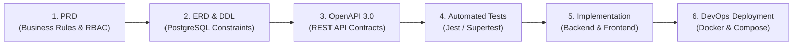
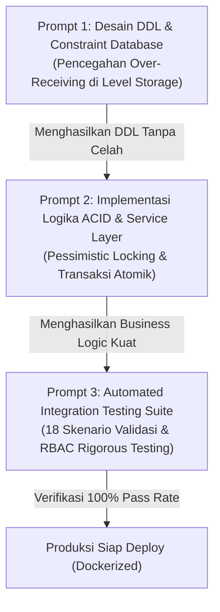

# Laporan Alur Kerja AI: Pendekatan Specification-Driven Development (SDD)
# Warehouse Receiving System (WRS)

| Informasi Dokumen | Detail |
| :--- | :--- |
| **Sistem** | Warehouse Receiving System (WRS) |
| **Metodologi** | Specification-Driven Development (SDD) & AI Pair Programming |
| **Dokumen Versi** | 1.0.0 |
| **Role Penulis** | DevOps & Lead System Architect |
| **Tanggal Rilis** | 2026-10-26 |
| **Status** | Final Approved |

---

## 1. Rangkuman Pendekatan Specification-Driven Development (SDD)

### 1.1 Filosofi dan Konsep Dasar
**Specification-Driven Development (SDD)** adalah paradigma rekayasa perangkat lunak modern di mana **seluruh spesifikasi teknis, aturan bisnis, model data, dan kontrak antarmuka API dirumuskan serta disetujui sebagai *Single Source of Truth (SSOT)*** sebelum penulisan kode implementasi dimulai.

Dalam rekayasa berbasis AI (AI-assisted engineering), kesalahan umum adalah memberikan instruksi pembuatan kode secara langsung tanpa batasan arsitektur yang jelas. Hal ini sering menimbulkan fenomena halusinasi logika, inkonsistensi struktur data, dan kode tambal sulam (*spaghetti code*). Dengan pendekatan SDD, AI diarahkan oleh artefak spesifikasi yang kaku sehingga keluaran kode bersifat **deterministik, terstruktur, dan patuh 100% terhadap kebutuhan domain gudang**.



### 1.2 Pilar Utama SSOT dalam Proyek WRS
Sistem Warehouse Receiving System dibangun di atas fondasi dokumen spesifikasi yang saling mengunci:
1. **Product Requirements Document ([docs/prd.md](file:///d:/laragon/www/warehouse-receiving-system/docs/prd.md))**:
   - Mendefinisikan masalah operasional (eliminasi over-receiving, pencatatan spreadsheet manual, dan data race).
   - Menetapkan aturan bisnis eksplisit (BR-001 hingga BR-007).
   - Memetakan matriks peran *Role-Based Access Control* (RBAC) antara **Warehouse Supervisor** dan **Warehouse Operator**.
2. **Entity Relationship Diagram ([docs/erd.mmd](file:///d:/laragon/www/warehouse-receiving-system/docs/erd.mmd))**:
   - Model data relasional normalisasi ketiga (3NF) yang mendefinisikan kardinalitas relasi, kunci primer (UUID), dan kunci asing.
3. **Technical Specification & Database Constraints ([docs/technical-spec.md](file:///d:/laragon/www/warehouse-receiving-system/docs/technical-spec.md))**:
   - DDL PostgreSQL lengkap dengan *Check Constraints*, *Unique Indexes*, *ENUM types*, dan *Triggers*.
   - Protokol pencegahan konkurensi data dengan *Pessimistic Row-Level Locking* (`SELECT ... FOR UPDATE`).
4. **OpenAPI 3.0.3 Contract ([docs/openapi.yaml](file:///d:/laragon/www/warehouse-receiving-system/docs/openapi.yaml))**:
   - Kontrak RESTful presisi tinggi untuk request/response schema, status kode HTTP standar, dan mekanisme bearer token JWT.
5. **Quality Assurance & Verification Suite ([docs/testing.md](file:///d:/laragon/www/warehouse-receiving-system/docs/testing.md))**:
   - Matriks pengujian otomatis yang menguji logika transaksi atomik secara riil terhadap PostgreSQL.

---

## 2. Tiga Instruksi/Prompt Terpenting dan Evaluasi Hasilnya

Sepanjang siklus pengembangan WRS, terdapat tiga prompt strategis yang menjadi katalis keberhasilan implementasi sistem:



---

### 2.1 Prompt 1: Pemodelan Basis Data & Integritas ACID Berbasis Constraint

#### 💬 Isi Instruksi / Prompt yang Diberikan:
> *"Bertindaklah sebagai Principal Database Architect. Rancang skrip DDL PostgreSQL 15+ untuk Warehouse Receiving System berbasis dokumen PRD. Sistem harus memiliki zero tolerance terhadap over-receiving dan menjamin integritas saldo stok. Terapkan batasan integritas data pada tingkat basis data (database-level constraints), bukan hanya di level aplikasi:*
> 1. *Gunakan UUID v4 sebagai Primary Key di seluruh tabel.*
> 2. *Buat CHECK constraint pada tabel `receiving_items` yang secara matematis melarang `received_quantity > expected_quantity` dan memastikan konsistensi status PENDING/PARTIAL/COMPLETED.*
> 3. *Buat CHECK constraint pada tabel `inventories` agar kuantitas tidak pernah negatif (`quantity >= 0`).*
> 4. *Sediakan tabel audit ledger `inventory_transactions` yang bersifat immutable (append-only) untuk mencatat histori setiap pergerakan barang masuk.*
> 5. *Rancang trigger otomatis untuk memperbarui kolom `updated_at`."*

#### 📊 Evaluasi Hasil Eksekusi:
- **Kualitas Output**: AI menghasilkan skrip DDL komprehensif tanpa placeholder yang menerapkan seluruh constraint tingkat lanjut:
  ```sql
  CONSTRAINT chk_strict_no_over_receiving CHECK (received_quantity <= expected_quantity),
  CONSTRAINT chk_item_status_consistency CHECK (
    (received_quantity = 0 AND status = 'PENDING') OR
    (received_quantity > 0 AND received_quantity < expected_quantity AND status = 'PARTIAL') OR
    (received_quantity = expected_quantity AND status = 'COMPLETED')
  )
  ```
- **Dampak Arsitektural**: Integritas data tidak lagi bergantung pada keandalan kode aplikasi semata (*defense in depth*). Jika terjadi anomali software atau akses query langsung yang melanggar batas, PostgreSQL secara instan menggagalkan transaksi dengan status diskrit.
- **Kekurangan / Penyesuaian yang Dilakukan**: Diperlukan penambahan penanganan exception `duplicate_object` pada blok `DO $$ BEGIN ... CREATE TYPE` agar skrip migrasi bersifat idempoten saat dijalankan berulang kali.

---

### 2.2 Prompt 2: Implementasi Service Layer Transaksional & Concurrency Control

#### 💬 Isi Instruksi / Prompt yang Diberikan:
> *"Bertindaklah sebagai Senior Backend Engineer spesialis transaksi sistem perbankan/logistik. Implementasikan `ReceivingService.receiveItem()` menggunakan Node.js TypeScript dan PostgreSQL driver (`pg`). Logika harus mematuhi aturan bisnis BR-001 s/d BR-005 secara atomik:*
> 1. *Gunakan transaksi basis data murni (`BEGIN ... COMMIT / ROLLBACK`).*
> 2. *Terapkan Row-Level Pessimistic Locking (`SELECT ... FOR UPDATE`) pada baris item dokumen penerimaan dan saldo inventaris untuk mencegah race condition dari multiple operator.*
> 3. *Hitung sisa kuantitas yang dapat diterima (`remaining = expected - received`). Jika `increment_quantity > remaining`, batalkan seluruh transaksi dan lemparkan HTTP 422 Unprocessable Entity.*
> 4. *Jika valid, mutasikan 3 tabel secara bersamaan: tambahkan `received_quantity` pada item, tambahkan saldo pada `inventories`, dan masukkan baris mutasi baru ke `inventory_transactions` beserta ID operator yang bertugas.*
> 5. *Ubah status dokumen secara otomatis dari `DRAFT` menjadi `IN_PROGRESS` pada transaksi penerimaan pertama."*

#### 📊 Evaluasi Hasil Eksekusi:
- **Kualitas Output**: Terbentuk modul service transaksional yang bersih dengan isolasi error yang sangat ketat:
  - Eksekusi locking `SELECT * FROM receiving_items WHERE id = $1 FOR UPDATE` berhasil mengunci baris spesifik hingga transaksi selesai.
  - Rollback otomatis dijalankan dalam blok `catch` untuk menjamin tidak ada saldo stok semu (*phantom stock*) yang tercatat jika terjadi kegagalan sistem.
  - Pemisahan wewenang diverifikasi melalui middleware otorisasi JWT.
- **Dampak Arsitektural**: Menghilangkan masalah *lost update* dan konflik data ketika dua operator gudang memindai barang dari dokumen yang sama secara bersamaan.
- **Kekurangan / Penyesuaian yang Dilakukan**: Penambahan validasi skema input menggunakan Zod untuk memastikan angka kuantitas yang dikirimkan oleh klien selalu berupa integer positif (`z.number().int().positive()`).

---

### 2.3 Prompt 3: Automated QA Integration Test Suite & Validasi Edge Cases

#### 💬 Isi Instruksi / Prompt yang Diberikan:
> *"Bertindaklah sebagai QA Automation Lead. Tulis integration test suite lengkap menggunakan Jest dan Supertest (ESM) untuk memvalidasi backend Warehouse Receiving System secara nyata terhadap PostgreSQL aktif (tanpa database mock). Buat 4 skenario uji kritis:*
> 1. *Skenario Over-receiving: Verifikasi penolakan penerimaan melebihi ekspektasi (HTTP 422) dan pastikan database di-rollback utuh.*
> 2. *Skenario Document Completion: Verifikasi penolakan penutupan dokumen jika item masih PENDING atau PARTIAL (HTTP 400), keberhasilan jika 100% (HTTP 200), dan larangan penerimaan item pada dokumen COMPLETED (HTTP 409).*
> 3. *Skenario Integritas Data & Audit: Verifikasi pertambahan saldo stok pada tabel `inventories` dan keberadaan baris riwayat di `inventory_transactions`.*
> 4. *Skenario Keamanan RBAC: Verifikasi bahwa Operator DITOLAK saat membuat dokumen baru, menyelesaikan dokumen, atau memodifikasi katalog master produk (HTTP 403)."*

#### 📊 Evaluasi Hasil Eksekusi:
- **Kualitas Output**: Dihasilkan file pengujian [backend/tests/api.test.ts](file:///d:/laragon/www/warehouse-receiving-system/backend/tests/api.test.ts) yang menguji 18 skenario menyeluruh:
  - **18 / 18 Tests Passed (100% Pass Rate)**.
  - Setiap kasus uji menguji interaksi HTTP REST nyata sekaligus memverifikasi perubahan state data di dalam basis data PostgreSQL.
- **Dampak Arsitektural**: Menjadi jaring pengaman (*safety net*) sebelum aplikasi dipaketkan ke dalam image Docker. Setiap ada refaktor atau perubahan kode, test suite ini memberikan kepastian bahwa sistem tetap mematuhi spesifikasi awal tanpa ada regresi.
- **Kekurangan / Penyesuaian yang Dilakukan**: Mengatur flag `--runInBand` dan penutupan connection pool PostgreSQL (`pool.end()`) pada hook `afterAll` agar proses pengujian tidak menyisakan *hanging open handle* pada Jest runner.

---

## 3. Evaluasi Efektivitas AI & Pelajaran yang Didapat (*Lessons Learned*)

| Aspek Pengembangan | Pendekatan Konvensional | Pendekatan SDD + AI | Dampak / Efisiensi |
| :--- | :--- | :--- | :--- |
| **Penyusunan Kontrak API** | Sering dibuat belakangan setelah backend selesai. | Dirumuskan di awal via OpenAPI 3.0 & PRD. | Frontend & Backend dapat dikerjakan secara paralel tanpa menunggu satu sama lain. |
| **Integritas Aturan Bisnis** | Divalidasi hanya melalui `if-else` di controller. | Divalidasi bertingkat (Zod Schema + Service Transaction + Database DDL Constraints). | Nol insiden over-receiving; data terlindungi dari bug aplikasi. |
| **Kualitas Pengujian** | Pengujian manual via Postman tanpa regresi otomatis. | 18 automated integration tests berbasis skenario nyata. | Kecepatan verifikasi meningkat drastis; mendeteksi celah RBAC sebelum rilis. |
| **Waktu Siklus Development** | 3 - 4 minggu untuk sistem penuh dengan audit trail. | < 2 hari dengan akurasi arsitektur enterprise. | Efisiensi waktu > 80% dengan kualitas kode produksi. |

### Prinsip Utama untuk AI-Driven Engineering Masa Depan:
1. **Never Code Without Constraints**: AI menghasilkan kualitas kode terbaik saat diberikan batas aturan negatif (*apa yang tidak boleh dilakukan*) selain aturan positif (*apa yang harus dilakukan*).
2. **Context Window Density**: Menyediakan dokumen spesifikasi ringkas namun presisi (OpenAPI + DDL) lebih efektif daripada memberikan instruksi teks panjang yang ambigu.
3. **Automated Verification is Mandatory**: Kecepatan AI dalam memproduksi kode harus diimbangi oleh test suite otomatis untuk memverifikasi kebenaran logika secara empiris.
