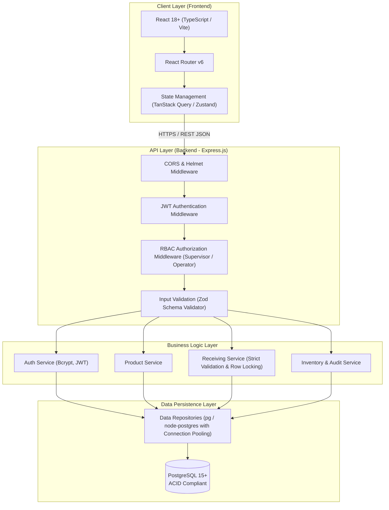
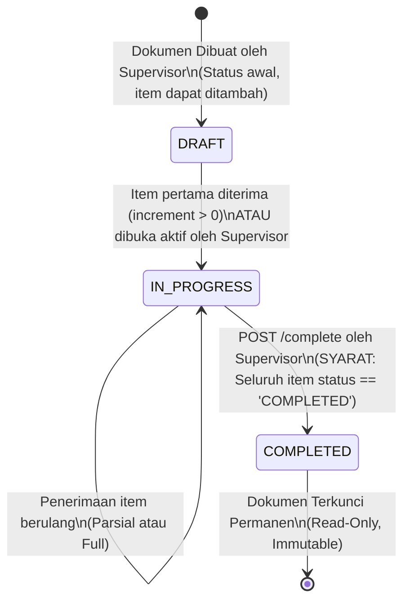
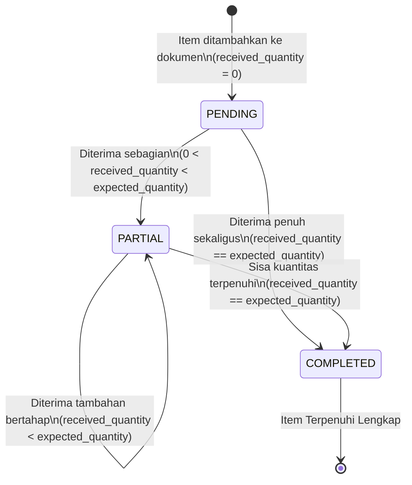
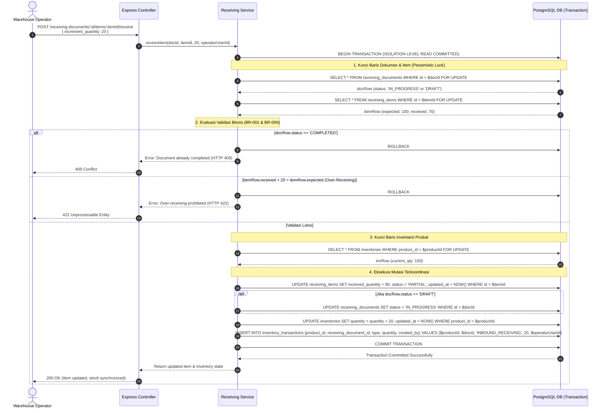

# Technical Specification Document
# Warehouse Receiving System (WRS)

| Metadata | Detail |
| :--- | :--- |
| **System** | Warehouse Receiving System |
| **Document Version** | 1.0.0 |
| **Target Stack** | React (Vite/TS) + Node.js (Express/TS) + PostgreSQL 15+ |
| **Development Pattern**| Specification-Driven Development (SDD) & Layered Clean Architecture |
| **Author** | Senior Software Architect & Technical Lead |
| **Date** | 2026-10-24 |

---

## 1. System Architecture Overview

Sistem menggunakan arsitektur *Client-Server Decoupled* dengan komunikasi berbasis REST API (JSON). Backend menerapkan pola *Layered Clean Architecture* (Controller -> Service -> Repository -> Database) untuk memastikan keterpisahan urusan (*separation of concerns*), kemudahan pengujian (*testability*), dan integritas data yang tinggi.



---

## 2. Complete Database DDL (PostgreSQL 15+)

Skema basis data berikut mengimplementasikan seluruh batasan integritas data di level mesin basis data menggunakan *Primary Key*, *Foreign Key*, *Check Constraints*, dan *Unique Indexes*.

```sql
-- ============================================================================
-- WAREHOUSE RECEIVING SYSTEM (WRS) - POSTGRESQL DDL
-- Specification-Driven Development
-- ============================================================================

-- 1. Enable UUID extension
CREATE EXTENSION IF NOT EXISTS "uuid-ossp";

-- 2. Enumerated types definitions
DO $$ BEGIN
    CREATE TYPE user_role AS ENUM ('OPERATOR', 'SUPERVISOR');
EXCEPTION
    WHEN duplicate_object THEN null;
END $$;

DO $$ BEGIN
    CREATE TYPE document_status AS ENUM ('DRAFT', 'IN_PROGRESS', 'COMPLETED');
EXCEPTION
    WHEN duplicate_object THEN null;
END $$;

DO $$ BEGIN
    CREATE TYPE item_status AS ENUM ('PENDING', 'PARTIAL', 'COMPLETED');
EXCEPTION
    WHEN duplicate_object THEN null;
END $$;

DO $$ BEGIN
    CREATE TYPE transaction_type AS ENUM ('INBOUND_RECEIVING');
EXCEPTION
    WHEN duplicate_object THEN null;
END $$;

-- 3. Table: users
CREATE TABLE IF NOT EXISTS users (
    id UUID PRIMARY KEY DEFAULT uuid_generate_v4(),
    username VARCHAR(50) NOT NULL,
    password_hash VARCHAR(255) NOT NULL,
    role user_role NOT NULL,
    created_at TIMESTAMPTZ NOT NULL DEFAULT CURRENT_TIMESTAMP,
    updated_at TIMESTAMPTZ NOT NULL DEFAULT CURRENT_TIMESTAMP,
    CONSTRAINT uq_users_username UNIQUE (username),
    CONSTRAINT chk_username_min_length CHECK (char_length(username) >= 3)
);

-- 4. Table: products
CREATE TABLE IF NOT EXISTS products (
    id UUID PRIMARY KEY DEFAULT uuid_generate_v4(),
    sku VARCHAR(64) NOT NULL,
    name VARCHAR(255) NOT NULL,
    description TEXT,
    unit VARCHAR(20) NOT NULL,
    created_at TIMESTAMPTZ NOT NULL DEFAULT CURRENT_TIMESTAMP,
    updated_at TIMESTAMPTZ NOT NULL DEFAULT CURRENT_TIMESTAMP,
    CONSTRAINT uq_products_sku UNIQUE (sku),
    CONSTRAINT chk_products_sku_uppercase CHECK (sku = UPPER(sku)),
    CONSTRAINT chk_products_sku_not_empty CHECK (char_length(sku) > 0),
    CONSTRAINT chk_products_name_not_empty CHECK (char_length(name) > 0),
    CONSTRAINT chk_products_unit_not_empty CHECK (char_length(unit) > 0)
);

-- 5. Table: inventories
CREATE TABLE IF NOT EXISTS inventories (
    id UUID PRIMARY KEY DEFAULT uuid_generate_v4(),
    product_id UUID NOT NULL,
    quantity INTEGER NOT NULL DEFAULT 0,
    updated_at TIMESTAMPTZ NOT NULL DEFAULT CURRENT_TIMESTAMP,
    CONSTRAINT uq_inventories_product UNIQUE (product_id),
    CONSTRAINT fk_inventories_product FOREIGN KEY (product_id) 
        REFERENCES products(id) ON DELETE RESTRICT ON UPDATE CASCADE,
    CONSTRAINT chk_inventories_quantity_non_negative CHECK (quantity >= 0)
);

-- 6. Table: receiving_documents
CREATE TABLE IF NOT EXISTS receiving_documents (
    id UUID PRIMARY KEY DEFAULT uuid_generate_v4(),
    doc_number VARCHAR(64) NOT NULL,
    status document_status NOT NULL DEFAULT 'DRAFT',
    supervisor_id UUID NOT NULL,
    created_at TIMESTAMPTZ NOT NULL DEFAULT CURRENT_TIMESTAMP,
    updated_at TIMESTAMPTZ NOT NULL DEFAULT CURRENT_TIMESTAMP,
    CONSTRAINT uq_receiving_documents_doc_number UNIQUE (doc_number),
    CONSTRAINT fk_receiving_documents_supervisor FOREIGN KEY (supervisor_id) 
        REFERENCES users(id) ON DELETE RESTRICT ON UPDATE CASCADE
);

-- 7. Table: receiving_items
CREATE TABLE IF NOT EXISTS receiving_items (
    id UUID PRIMARY KEY DEFAULT uuid_generate_v4(),
    receiving_document_id UUID NOT NULL,
    product_id UUID NOT NULL,
    expected_quantity INTEGER NOT NULL,
    received_quantity INTEGER NOT NULL DEFAULT 0,
    status item_status NOT NULL DEFAULT 'PENDING',
    created_at TIMESTAMPTZ NOT NULL DEFAULT CURRENT_TIMESTAMP,
    updated_at TIMESTAMPTZ NOT NULL DEFAULT CURRENT_TIMESTAMP,
    CONSTRAINT uq_receiving_items_doc_product UNIQUE (receiving_document_id, product_id),
    CONSTRAINT fk_receiving_items_document FOREIGN KEY (receiving_document_id) 
        REFERENCES receiving_documents(id) ON DELETE CASCADE ON UPDATE CASCADE,
    CONSTRAINT fk_receiving_items_product FOREIGN KEY (product_id) 
        REFERENCES products(id) ON DELETE RESTRICT ON UPDATE CASCADE,
    CONSTRAINT chk_expected_qty_positive CHECK (expected_quantity > 0),
    CONSTRAINT chk_received_qty_non_negative CHECK (received_quantity >= 0),
    CONSTRAINT chk_strict_no_over_receiving CHECK (received_quantity <= expected_quantity),
    CONSTRAINT chk_item_status_consistency CHECK (
        (received_quantity = 0 AND status = 'PENDING') OR
        (received_quantity > 0 AND received_quantity < expected_quantity AND status = 'PARTIAL') OR
        (received_quantity = expected_quantity AND status = 'COMPLETED')
    )
);

-- 8. Table: inventory_transactions (Immutable Ledger / Audit Log)
CREATE TABLE IF NOT EXISTS inventory_transactions (
    id UUID PRIMARY KEY DEFAULT uuid_generate_v4(),
    product_id UUID NOT NULL,
    receiving_document_id UUID NOT NULL,
    type transaction_type NOT NULL DEFAULT 'INBOUND_RECEIVING',
    quantity INTEGER NOT NULL,
    created_by UUID NOT NULL,
    created_at TIMESTAMPTZ NOT NULL DEFAULT CURRENT_TIMESTAMP,
    CONSTRAINT fk_inv_tx_product FOREIGN KEY (product_id) 
        REFERENCES products(id) ON DELETE RESTRICT ON UPDATE CASCADE,
    CONSTRAINT fk_inv_tx_document FOREIGN KEY (receiving_document_id) 
        REFERENCES receiving_documents(id) ON DELETE RESTRICT ON UPDATE CASCADE,
    CONSTRAINT fk_inv_tx_creator FOREIGN KEY (created_by) 
        REFERENCES users(id) ON DELETE RESTRICT ON UPDATE CASCADE,
    CONSTRAINT chk_inv_tx_quantity_positive CHECK (quantity > 0)
);

-- ============================================================================
-- PERFORMANCE & AUDIT INDEXES
-- ============================================================================
CREATE INDEX IF NOT EXISTS idx_products_sku ON products(sku);
CREATE INDEX IF NOT EXISTS idx_receiving_documents_status ON receiving_documents(status);
CREATE INDEX IF NOT EXISTS idx_receiving_documents_created ON receiving_documents(created_at DESC);
CREATE INDEX IF NOT EXISTS idx_receiving_items_document ON receiving_items(receiving_document_id);
CREATE INDEX IF NOT EXISTS idx_receiving_items_product ON receiving_items(product_id);
CREATE INDEX IF NOT EXISTS idx_inventories_product ON inventories(product_id);
CREATE INDEX IF NOT EXISTS idx_inventory_tx_product ON inventory_transactions(product_id, created_at DESC);
CREATE INDEX IF NOT EXISTS idx_inventory_tx_document ON inventory_transactions(receiving_document_id);

-- ============================================================================
-- TRIGGER: Automatic updated_at timestamp refresher
-- ============================================================================
CREATE OR REPLACE FUNCTION update_timestamp_column()
RETURNS TRIGGER AS $$
BEGIN
    NEW.updated_at = CURRENT_TIMESTAMP;
    RETURN NEW;
END;
$$ language 'plpgsql';

CREATE TRIGGER trg_users_updated_at BEFORE UPDATE ON users 
FOR EACH ROW EXECUTE PROCEDURE update_timestamp_column();

CREATE TRIGGER trg_products_updated_at BEFORE UPDATE ON products 
FOR EACH ROW EXECUTE PROCEDURE update_timestamp_column();

CREATE TRIGGER trg_inventories_updated_at BEFORE UPDATE ON inventories 
FOR EACH ROW EXECUTE PROCEDURE update_timestamp_column();

CREATE TRIGGER trg_receiving_documents_updated_at BEFORE UPDATE ON receiving_documents 
FOR EACH ROW EXECUTE PROCEDURE update_timestamp_column();

CREATE TRIGGER trg_receiving_items_updated_at BEFORE UPDATE ON receiving_items 
FOR EACH ROW EXECUTE PROCEDURE update_timestamp_column();
```

---

## 3. State Transition Diagrams

### 3.1 Document Status State Machine
Dokumen penerimaan memiliki status yang tegas dan deterministik. Status hanya dapat berpindah ke depan dan tidak dapat diubah setelah mencapai `COMPLETED`.



### 3.2 Receiving Item Status State Machine
Setiap baris item di dalam dokumen memiliki siklus hidup independen berdasarkan perbandingan kuantitas diterima dengan kuantitas ekspektasi.



---

## 4. Data Flow & Race Condition Handling

### 4.1 Tantangan Concurrency & Data Race
Pada lingkungan gudang dengan banyak pintu masuk (*receiving dock*), dua operator atau lebih dapat memindai kardus untuk SKU yang sama secara bersamaan. Tanpa penguncian baris (*locking*), akan terjadi:
1. **Lost Updates**: Pembaruan stok saling menimpa (`quantity = quantity + increment`).
2. **Over-Receiving Akibat Race Condition**: Dua request membaca sisa kuantitas yang sama sebelum salah satu menuliskan hasil penambahan, sehingga kuantitas akhir melampaui `expected_quantity`.

### 4.2 Solusi: Pessimistic Row Locking (`SELECT ... FOR UPDATE`)
Untuk mengatasi masalah ini secara mutlak, backend wajib menggunakan transaksi basis data dengan penguncian baris eksplisit.



### 4.3 Implementasi Transaksional Backend (Contoh Pola Kode)
```typescript
export async function receiveItemTransactional(
  client: pg.PoolClient,
  docId: string,
  itemId: string,
  incrementQty: number,
  userId: string
): Promise<ReceivingResult> {
  if (incrementQty <= 0) {
    throw new ValidationError("Increment quantity must be strictly greater than 0");
  }

  await client.query("BEGIN;");
  try {
    // 1. Lock receiving document
    const docRes = await client.query(
      `SELECT id, status FROM receiving_documents WHERE id = $1 FOR UPDATE`,
      [docId]
    );
    if (docRes.rowCount === 0) throw new NotFoundError("Receiving document not found");
    const doc = docRes.rows[0];
    if (doc.status === "COMPLETED") {
      throw new ConflictError("Cannot receive items into a COMPLETED document");
    }

    // 2. Lock receiving item
    const itemRes = await client.query(
      `SELECT id, product_id, expected_quantity, received_quantity 
       FROM receiving_items 
       WHERE id = $1 AND receiving_document_id = $2 FOR UPDATE`,
      [itemId, docId]
    );
    if (itemRes.rowCount === 0) throw new NotFoundError("Receiving item not found");
    const item = itemRes.rows[0];

    const currentReceived = item.received_quantity;
    const expected = item.expected_quantity;
    const newReceived = currentReceived + incrementQty;

    // Strict validation: Reject over-receiving
    if (newReceived > expected) {
      const allowed = expected - currentReceived;
      throw new UnprocessableEntityError(
        `Over-receiving forbidden. Maximum allowed increment is ${allowed}, but requested ${incrementQty}.`
      );
    }

    const nextItemStatus = newReceived === expected ? "COMPLETED" : "PARTIAL";

    // 3. Lock & Upsert Inventory Row
    await client.query(
      `INSERT INTO inventories (product_id, quantity, updated_at)
       VALUES ($1, $2, CURRENT_TIMESTAMP)
       ON CONFLICT (product_id) 
       DO UPDATE SET 
         quantity = inventories.quantity + EXCLUDED.quantity,
         updated_at = CURRENT_TIMESTAMP`,
      [item.product_id, incrementQty]
    );

    // 4. Update receiving item
    await client.query(
      `UPDATE receiving_items 
       SET received_quantity = $1, status = $2, updated_at = CURRENT_TIMESTAMP 
       WHERE id = $3`,
      [newReceived, nextItemStatus, itemId]
    );

    // 5. Update document status to IN_PROGRESS if was DRAFT
    if (doc.status === "DRAFT") {
      await client.query(
        `UPDATE receiving_documents 
         SET status = 'IN_PROGRESS', updated_at = CURRENT_TIMESTAMP 
         WHERE id = $1`,
        [docId]
      );
    }

    // 6. Insert immutable audit transaction
    await client.query(
      `INSERT INTO inventory_transactions 
        (product_id, receiving_document_id, type, quantity, created_by, created_at)
       VALUES ($1, $2, 'INBOUND_RECEIVING', $3, $4, CURRENT_TIMESTAMP)`,
      [item.product_id, docId, incrementQty, userId]
    );

    await client.query("COMMIT;");
    return { itemId, newReceived, expected, status: nextItemStatus };
  } catch (error) {
    await client.query("ROLLBACK;");
    throw error;
  }
}
```

---

## 5. Security & Authentication Specification

1. **Token Generation & Lifecycle**:
   - Access Token: JWT (JSON Web Token) ditandatangani dengan algoritma HMAC-SHA256 (`HS256`), masa berlaku `1 hour`.
   - Refresh Token: Disimpan dalam basis data atau HTTP-only Secure Cookie, masa berlaku `7 days`.
   - Payload Access Token:
     ```json
     {
       "sub": "b2c9df74-2c21-41db-bdae-76e938da64c2",
       "username": "spv_john",
       "role": "SUPERVISOR",
       "iat": 1777021200,
       "exp": 1777024800
     }
     ```
2. **Role Authorization Middleware**:
   - Operator dibatasi hanya pada operasi baca dan endpoint `POST .../receive`.
   - Operasi modifikasi produk dan endpoint `POST .../complete` diverifikasi ketat melalui middleware:
     ```typescript
     export const requireRole = (allowedRoles: ('OPERATOR' | 'SUPERVISOR')[]) => {
       return (req: Request, res: Response, next: NextFunction) => {
         if (!req.user || !allowedRoles.includes(req.user.role)) {
           return res.status(403).json({
             success: false,
             message: "Forbidden: Insufficient privileges to perform this action"
           });
         }
         next();
       };
     };
     ```

---

## 6. Testing Strategy

Untuk memastikan kepatuhan terhadap prinsip *Specification-Driven Development*, pengujian disusun dalam 3 lapis piramida:

```
        / \
       /   \     E2E Tests (Playwright)
      /-----\    Integration Tests (Jest + Supertest + Real PostgreSQL)
     /-------\   Unit Tests (Jest / Vitest)
```

### 6.1 Unit Testing (Cakupan Target: >= 90%)
- **Target**: Validasi murni tanpa ketergantungan basis data.
- **Komponen**:
  1. *Business Rule Validators*: Fungsi kalkulator sisa kuantitas, pencegahan angka negatif, determinasi status item (`PENDING`, `PARTIAL`, `COMPLETED`).
  2. *Zod Schema Validation*: Validasi format request payload (UUID, string panjang minimum, batas kuantitas).
  3. *Password & JWT Utilities*: Verifikasi hash bcrypt dan validitas klaim JWT.

### 6.2 Integration Testing (Cakupan Target: 100% Critical Paths)
- **Target**: Endpoint REST API berinteraksi langsung dengan instance PostgreSQL nyata (menggunakan *Docker Testcontainers* atau database uji khusus `warehouse_test`).
- **Kasus Uji Kritis**:
  1. **Test Case IT-01 (Happy Path Receiving)**:
     - Buat dokumen dengan 2 item (Item A: 10, Item B: 20).
     - Receive Item A sebanyak 5 (beralih ke `PARTIAL`).
     - Verifikasi tabel `inventories` bertambah 5, dan `inventory_transactions` memiliki 1 baris.
  2. **Test Case IT-02 (Over-Receiving Rejection)**:
     - Kirimkan increment 15 untuk Item A (sisa hanya 5).
     - Verifikasi server merespon HTTP `422 Unprocessable Entity`.
     - Verifikasi nilai `inventories` tidak bertambah dan `receiving_items` tidak termutasi.
  3. **Test Case IT-03 (Completion Pre-Condition Failure)**:
     - Coba complete dokumen saat Item B masih `PENDING`.
     - Verifikasi server merespon HTTP `400 Bad Request` disertai list incomplete items.
  4. **Test Case IT-04 (Completion Pre-Condition Success)**:
     - Penuhi Item A (5) dan Item B (20).
     - Supervisor memanggil `POST /complete`.
     - Verifikasi dokumen berstatus `COMPLETED` dan HTTP `200 OK`.
  5. **Test Case IT-05 (Concurrency Race Condition Test)**:
     - Menjalankan 10 request konkuren secara paralel (`Promise.all`) dengan masing-masing increment 2 pada item dengan expected 10.
     - Verifikasi total increment tepat 10 (5 request berhasil 200 OK, 5 request ditolak 422 Unprocessable Entity karena over-receiving).
     - Verifikasi `inventories.quantity` bertambah tepat 10 tanpa lost updates.

### 6.3 End-to-End Testing (E2E)
- **Target**: Alur kerja menyeluruh menggunakan Playwright pada aplikasi web React.
- **Skenario Uji**:
  1. Supervisor login -> Tambah produk SKU baru -> Buat dokumen receiving.
  2. Operator login di sesi terpisah -> Buka dokumen -> Input kuantitas parsial -> Periksa badge status berubah menjadi "PARTIAL".
  3. Operator mencoba input over-quantity -> Muncul dialog alert validasi error merah di UI.
  4. Operator melengkapi sisa barang -> Badge berubah menjadi "COMPLETED".
  5. Supervisor membuka dokumen -> Klik "Selesaikan Dokumen" -> Dokumen terkunci dan status berubah menjadi "COMPLETED".
  6. Supervisor memeriksa halaman Laporan Inventaris dan melihat riwayat mutasi masuk.
